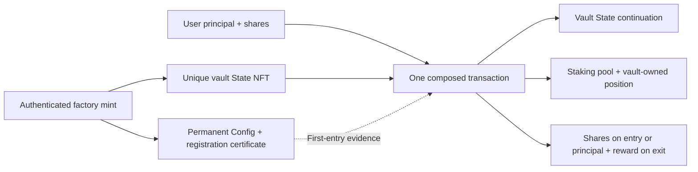

# Factory-admitted CTVS-1 staking vault example

A complete, isolated integration example for **single-staking-protocol**. It includes the
full staking contract, staking-aware vault controller, authenticated factory,
shared authorization/registration codecs, unsigned transaction builders and a runnable
reward-bearing lifecycle. It does not modify either reference family's blueprint or
establish a new normative CTVS wire format.

## Run locally

From `reference/` (Node version as specified by the workspace):

```sh
npm ci --ignore-scripts
npm run test:staking-example
npm run example:staking
npm run inspect:staking
```

`test:staking-example` checks the example's TypeScript, imported source bindings and
compiled transaction tests. `example:staking` writes each complete unsigned CBOR body
and `evidence.json` to `reference/artifacts/staking-vault/local/`. It performs:

1. Factory policy reference and two controller-prefix publications.
2. Controller publication, then one-shot vault genesis and factory certificate mint.
3. Staking reference publication, independent pool genesis and reward notification.
4. Deposit 10 principal tokens and create the vault-owned position/NFT.
5. Mint an exact 10,000,000,000,000 share units for another 10 principal tokens,
   contributing bounded reward equalization for the new shares.
6. Withdraw 5, atomically unstaking and claiming; preserve remaining shareholders' rewards.
7. Redeem the remaining shares and claim the remaining entitlement.
8. Re-enter with the same empty position, then withdraw all 10 with a fixed-asset withdrawal.

Token amounts above use the fixture's six decimal convention. Contract arithmetic and
builder arguments always use base-unit integers. Principal and reward assets are distinct;
ADA pays transaction fees and storage reserves, and is not staked.

The local ledger starts with **fabricated public funding/token balances and key hashes**.
Every subsequent State/Config/certificate/pool/position transition is constructed in full
and evaluated against the actual compiled programs. Ledger advancement applies unsigned
outputs directly for the next stage. There are no keys or signatures, and no emulator or
node submission. This proves compiled phase-two behavior and client effect checks, not
phase-one acceptance or live deployment readiness. A separate synthetic nonempty-pool
fixture verifies first entry's principal delta; it does not manufacture a live observation.

## Follow the contracts and builders

| Path | Purpose |
| --- | --- |
| `onchain/staking/validators/single_staking.ak` | Complete staking pool mint/spend validator, including wallet and vault positions and `WithdrawAndClaim` |
| `onchain/staking/lib/staking/` | Staking rewards, admission, registration and exact versioned controller authorization |
| `onchain/factory/validators/authenticated_factory.ak` | Mint the recognized controller's registration certificate together with authenticated empty Config/State |
| `onchain/factory/validators/factory_vault.ak` | Combined vault entrypoint, dispatched through the staking-aware State validator |
| `onchain/vault/lib/staking_ctvs1/staking_state.ak` | Principal/share/reward accounting and composed staking transition validation |
| `onchain/vault/lib/staking_ctvs1/controller_decode.ak` | Optimized decoder for the agreed versioned authorization envelope |
| `vendor/client/protocol/shared-v1/` | TypeScript envelope/registration codecs and golden vectors |
| `vendor/client/src/factory/` | Preparation, publication, genesis, admission and composed deposit/exit builders |
| `src/local/` | Readable complete unsigned example orchestration |
| `src/index.ts` | Public example facade for application integration |

Aiken library imports are compiled into their importing validator. `staking_state.ak`
is not another address or an independently called contract. One deposit transaction
consumes the vault's State and staking pool inputs, creates/updates the staking position,
mints/burns the required NFTs/shares and creates all continuations/payouts together.
Deposit specifies principal input; mint specifies exact shares and a maximum principal input
(the mint builder currently uses an existing position). Withdrawal specifies principal assets;
redemption specifies shares. Both use the staking
contract's atomic `WithdrawAndClaim` action and distribute this position's reward-token
entitlement. The State NFT stays unique throughout; it is not replaced with an operator key.

The two projects intentionally have separate `staking/*` module namespaces. Stage them
using the supplied build command, rather than flattening them into one Aiken project.
The current vault-side layout uses `staking/` for the protocol adapter and
`staking_ctvs1/staking_state.ak` for vault State validation. The full pool's
`onchain/staking/lib/staking/` contains its protocol implementation. These are separate
Aiken project namespaces. Both use the current version 2 position format.



## Import the existing factory and pool

See [IMPORTS.md](IMPORTS.md) for the concrete settings/import workflow and API example.
`profiles/preprod/` contains public historical factory, pool, vault and settings records,
plus [addresses and transaction hashes](profiles/preprod/TRANSACTIONS.md). `inspect:staking`
reproduces their exact policies, script addresses and Config/State/certificate datums locally.
It does not claim their UTxOs are still unspent. The old vault/position seeds are spent;
`vault:prepare` rejects their reuse.

The factory policy is derived from its **approved controller prefix hash, suffix and
Config lock**, not read blindly from a JSON field. The pool permanently commits to that
factory policy, its two assets, independent bootstrap seed, manager/distributor and unlocked
vault support. Each vault commits to that pool and its own position seed. A certificate is
minted automatically at genuine genesis; copying a registration JSON is never admission.
Later valid exits do not require a factory approval or certificate reference.

## Reproduce both complete contract builds

Use the exact compiler builds recorded by the imported deployments:

```sh
AIKEN_FACTORY=/path/to/aiken-1.1.22 \
AIKEN_STAKING=/path/to/aiken-1.1.23 \
npm run test:staking-contracts
```

Factory/controller: `aiken v1.1.22+39d6b04`, stdlib 3.1.0, fuzz 2.2.0.
Staking: `aiken v1.1.23+unknown`, stdlib 3.1.0. A different compiler identity fails explicitly.
The command stages disposable projects, uses canonical shared CTVS modules, binds the
Config lock in two passes, requires **byte-identical deployed programs for all six
factory/controller handlers and all three staking handlers**, and runs
**73 factory/controller** plus **254 staking** checks with seed 3098115174. Reports go to
`reference/artifacts/staking-vault/contracts/`. It never replaces imported evidence.
The source projects contain only current contracts; baseline blueprints and attestations
live under `evidence/`. Whole blueprint hashes differ when unused programs are removed.
Dependencies are fetched by Aiken when no `.build/dependency-cache/packages` cache exists.

The default repository check includes local compiled transaction tests and hash verification;
it does not silently substitute compiler 1.1.22 for staking 1.1.23 or claim a rebuild happened.
The explicit dual-compiler command is a separate reproducibility gate.

## Staking documentation

- [Authorization and registration](docs/STAKING-AUTHORIZATION.md) describes the current flow.
- [Interface specification](docs/STAKING-INTERFACE.json) is the canonical current JSON ABI.

Current progress and blockers are in [VALIDATION.md](VALIDATION.md).

These documents live outside the contract source folders. The original import snapshot and
delivery archive remain provenance data; the current snapshot binds the renamed documents.

## Source basis and limits

See [VALIDATION.md](VALIDATION.md) for measured tests, accounting, size headroom and limits.
See [SOURCES.md](SOURCES.md) for relocations, licensing, exact hash bindings, the historical
editor-file omission and the example-local parameter encoder required for deployed IDs.
The current staking contracts and source-bound evidence live here independently of either
sibling repository. Unused upstream CLI/token-generation code is not included. No `.env`, wallet secret, live signing CLI or submission command is included.

The confirmed Preprod cycles are historical integration evidence, not an independent review.
This example remains testnet-only and reports `deploymentReady=false`. Independent security
review, a signed/node-backed version of this new local harness, full two-vault plus wallet
transaction concurrency scenarios, operational recovery and live re-resolution of all
references/parameters remain separate acceptance work. Existing reference family tests and
artifacts retain their original role; the extension is not silently promoted into the standard.
